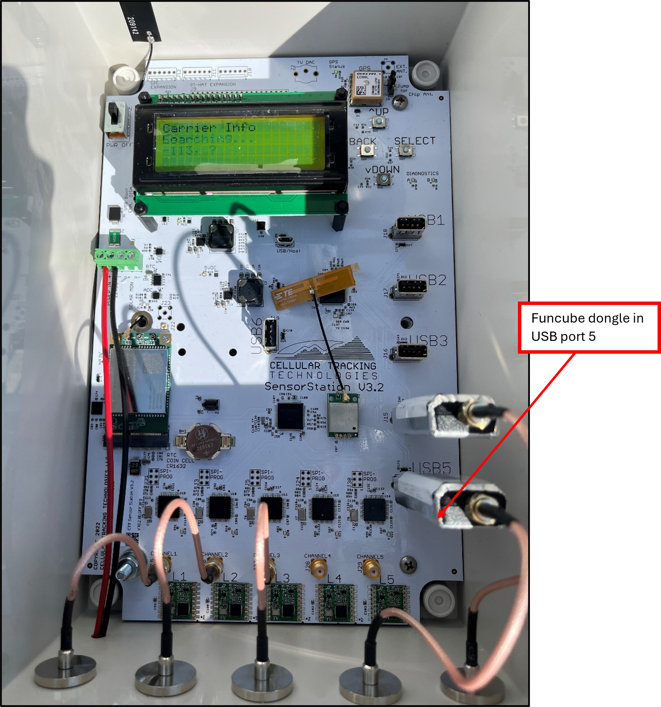

# Downloading Data from a SensorStation


More details on this process can be found in Cellular Tracking Technologies SensorStation Manual: [https://cellular-tracking-technologies.github.io/ctt\_documentation/SensorStation-User-Guide.html](https://cellular-tracking-technologies.github.io/ctt_documentation/SensorStation-User-Guide.html)


## Downloading data from a SensorStation using the web interface

**Note**: that if detection data has not been downloaded from a station for more than 6 months the direct ethernet cable connection should be used to ensure all data files are downloaded and not missed.

### Equipment



### Parts of the SensorStation

Components of the Version 3 SensorStation from Cellular Tracking Technologies:

<figure><figcaption></figcaption></figure>

SensorStation LCD screen:

<figure><figcaption></figcaption></figure>

The LCD screen is the main display that is used to navigate through the different settings of the SensorStation. There are four navigation buttons to the right of the screen labelled UP, DOWN, BACK, and SELECT that can be used to toggle through the menu options.

### Downloading data via ethernet cable

1. First ensure that the SensorStation is ON and the LCD screen is lit.
2. Use any open USB port and insert USB to ethernet adapter.
3. Connect your ethernet cable to the adapter then to your laptop (either via a direct ethernet port or using another USB to ethernet adapter).

<figure><figcaption></figcaption></figure>

4. Open a web browser (Chrome or Firefox) on your laptop and type in the url: **sensorstation.local**
5. The CTT SensorStation web interface will now be displayed on your web browser. If it doesn’t load right away, try refreshing your browser, then try restarting your laptop. If that still does not work, restart the SensorStation and try connecting to the web interface again. To restart the SensorStation, turn the power switch to **OFF**, wait 30 seconds, then turn the power switch to **ON** again and wait a couple minutes until the SensorStation boots up (it is ready when the LCD screen menu appears).

<figure><figcaption></figcaption></figure>

6. Scroll down to the “**Data Management**” section. You will need to download 2 sets of data, one for each of the antenna frequencies. Tags detected on 166 MHz antennas will be downloaded under “**Nanotag Data**” and tags detected on 434 MHz antennas will be downloaded under “**CTT Tag Data**”.

<figure><figcaption></figcaption></figure>

7. Click both the “**Download Current Data**” and “**Download Data Not Uploaded**” button under CTT Tag Data and Nanotag Data to download the data into zip files. Note, this may take a few minutes depending on how much data there is to download. Also note your browser may show the download as from an unknown source, and the download will not complete until you click “**Keep**”. There should be 2 separate zip folders downloaded. All the zip folders should download into the **Downloads** folder on your laptop. It doesn’t hurt to click “**Download Data Already Uploaded**” as well just to make sure everything is covered – it will likely just give a message saying “Nothing to download yet”, in which case you can just go back to the main interface.


**For visual instructions:** Watch this demonstration video on the Motus Wildlife Tracking System YouTube page [here](https://www.youtube.com/watch/dO8vrPuAJFA): [https://www.youtube.com/watch/dO8vrPuAJFA](https://www.youtube.com/watch/dO8vrPuAJFA).&#x20;

Note that this video uses an IP address as the web browser URL to connect to the SensorStation web interface, rather than “sensorstation.local”. Either option should work.


### Additional Motus station maintenance on web interface

While you are connected to the CTT web interface there are a few details you can check to ensure the Motus station is operating correctly.


**Reminder:** Please take screenshots of all details on the SensorStation and SensorGnome interface so that station operation can be verified and troubleshot at a later date.


1. Scroll down to the GPS section on the left-hand side of the screen and check to see that the Time and station GPS details are populated and accurate.

<figure><figcaption></figcaption></figure>

2. Under the “**Nanotag Data**” section, click on the “**Sensorgnome Interface**” button under Nanotag Data. You will be directed to the web interface that displays diagnostics for the 166 MHz antennas.

<figure><figcaption></figcaption></figure>

3. On the SensorGnome web interface, again check that the date, time, and GPS location are populated and look correct (the time stamp will be in UTC). You can also check that the 166 MHz antennas are active. The funcube dongles are the pieces wrapped in shiny silver tape. The USB ports these are plugged into on the board should correspond to the USB ports listed in the “**What I’m doing now**” and “**Devices**” sections on the web interface (USB ports 3 and 4 in the screenshot above).

<figure><figcaption></figcaption></figure>

## Downloading data from a SensorStation using FileZilla

If the download buttons on the web interface for SensorStation don’t work, or if you prefer to use FileZilla, you can use the FileZilla method to download data from SensorStations as well. The method is the same as for SensorGnomes, except that the credentials to connect are different.

### Equipment



Ethernet cable

<figure><figcaption></figcaption></figure>



USB to ethernet adapter (if no ethernet port on laptop you will need 2 adapters)

<figure><figcaption></figcaption></figure>



Laptop (with FileZilla).png>)





### Connecting to SensorStation via Ethernet

1. First ensure that the SensorStation is ON and the LCD screen is lit.
2. Use any open USB port and insert USB to ethernet adapter.
3. Connect your ethernet cable to the adapter then to your laptop (either via a direct ethernet port or using another USB to ethernet adapter).

<figure><figcaption></figcaption></figure>

### Downloading data via FileZilla

1. On your laptop, create a new folder on your Desktop and name it with the Motus station name and the date you are downloading data. This is where you will save the downloaded data.
2. While the SensorStation is connected to your laptop via Ethernet cable and USB-ethernet adapter, open FileZilla. In the left panel named “Local site:”, navigate to the folder you created on your laptop’s Desktop where you will save the downloaded data. Click on the folder so it appears in the bottom left panel.

<figure><figcaption></figcaption></figure>

3. In the top left bar, enter the following:

* Host: **sftp://sensorstation.local**
* Username: **ctt**
* Password: **ctt-station**


**Note**: Some of the older SensorStations have a different username and password (the host stays the same). If the above password doesn’t work, try **ctt-sensor** instead (keeping **ctt** as the username). If that still doesn’t work, try the username **pi** and the password **raspberry**.


<figure><figcaption></figcaption></figure>

4. Click “Quickconnect”. There will be a pop-up window that says “server’s host key is unknown”. Click “OK” and continue.

<figure><figcaption></figcaption></figure>

5. In the right panel named “Remote site:”, you will see the file directory for the SensorStation. Click the “/” at the top. Expand the file directory and click on following folders: “data”, then “SGdata”. A list of files with folders for each date will appear in the bottom right pane. Select all the folders for the dates you want to download. (Click the earliest date, then scroll down to the current date, hold Shift and click the current date to select all folders from first to last date.)
6. Right click on the selected folders and click “Add to queue”. At the bottom left of the page, you will see a tab named “Queued files” with the number of files.
7. At the top left, click the “Transfer” menu button, then click “Process queue”. The files will begin copying to the folder you created on your laptop’s Desktop. You should see a progress bar and the number of “Queued files” decreasing and the number of “Successful transfers” increasing. Wait until the queued files finish transferring.

<figure><figcaption></figcaption></figure>

8. To download station logs (which are helpful for troubleshooting issues), create a new folder in your Desktop or Documents with the station name, date, and indicate that it is logs (do **not** store logs in the same folder as sgdata). On Filezilla, on the right panel named “Remote site:”, you will see the file directory for the SensorStation. Click the “/” at the top. Expand the file directory and click on following folders: “var”, then “log”. Copy all of the files in the log folder you created on your laptop. Select all the folders and files in this folder.
9. Right click on the selected folders and click “Add to queue”. At the bottom left of the page, you will see a tab named “Queued files” with the number of files.
10. At the top left, click the “Transfer” menu button, then click “Process queue”. The files will begin copying to the folder you created on your laptop’s Desktop. You should see a progress bar and the number of “Queued files” decreasing and the number of “Successful transfers” increasing. Wait until the queued files finish transferring.
11. Check the folders you created on your Desktop – for the detection data, you should see a folder for each date there (all the transferred data). If the files are there, in FileZilla, you can click the button with a little white computer and a red X to disconnect the SensorStation.

<figure><figcaption></figcaption></figure>

12. You can now unplug your laptop from the SensorStation. Leave the SensorStation on and close the case.

## Downloading data from a SensorStation using a USB drive

### Equipment




USB flash drive (blank – no other files saved on the USB drive)

<figure><figcaption></figcaption></figure>



Laptop (highly recommended, but optional)

<figure><figcaption></figcaption></figure>



### Downloading data via USB

1. Use any open USB port and insert the USB flash drive.
2. Press **SELECT** to choose “**File Transfer**”.
3. Press **SELECT** to choose “**Mount USB**”. You should see a confirmation message saying “**USB Mount : success**”.
4. Press **BACK** to return to File Transfer menu.
5. Use the **DOWN** button to navigate to “**Download**” and press **SELECT**. You should see a confirmation message that the download has been successful.
6. Press **BACK** to return to File Transfer menu. Use the **DOWN** button to navigate to “**Unmount USB**” and press **SELECT**. Once you see the success confirmation you may remove the USB drive from the SensorStation.
7. We recommend you connect the USB to your laptop while at the station site to make sure that the files have been uploaded successfully.On the USB drive you will find several files including:

* GPS files
* Log files
* Raw-data files
* Two folders: SGData and uploaded
