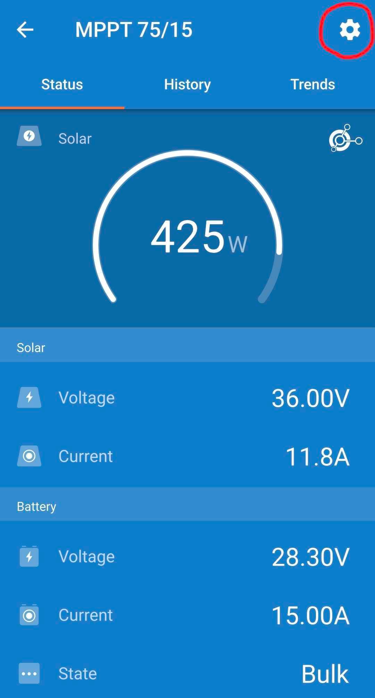
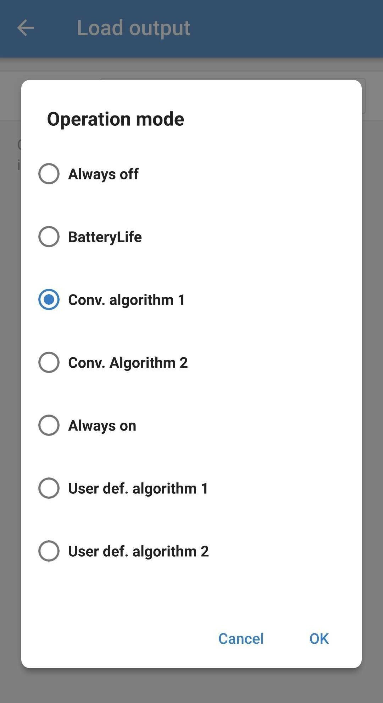
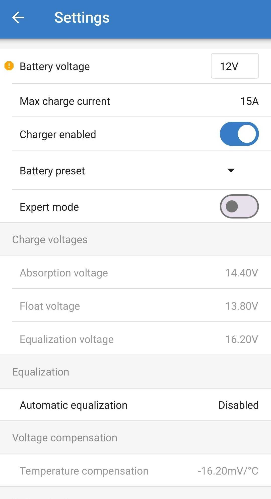
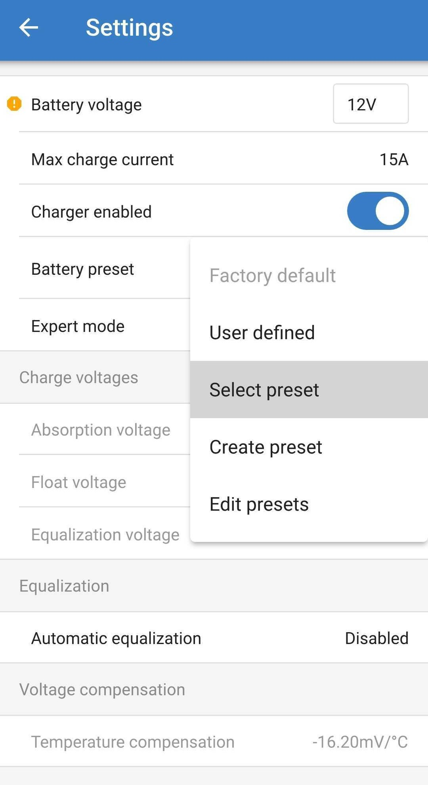
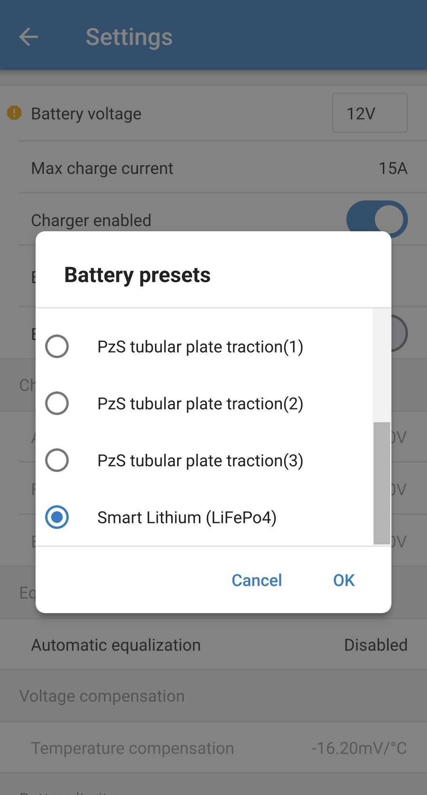

# Charge Controller Configuration Over Bluetooth

<figure><figcaption></figcaption></figure> <figure><figcaption></figcaption></figure>

## About

The charge controller comes preconfigured with a load output mode that isn't optimal for Motus stations and should be changed. In addition, the default charging profile is designed for AGM Lead Acid batteries so it should be switched to Lithium Iron Phosphate if you are using that chemistry.

## Prerequisites

* [VictronConnect App](https://www.victronenergy.com/victronconnectapp/victronconnect/downloads)
* [VE.Direct Bluetooth Smart Dongle](https://a.co/d/08uN3tWr) (if working with Victron Energy BlueSolar MPPT 75/15)

## Instructions

### Connecting for the first time



1. The charge controller needs to be connected to a battery in order to connect to it.
2. Remove the jumper and discard it (circled in red).



<figure><figcaption></figcaption></figure>





#### Victron Energy BlueSolar MPPT 75/15

1. Plug the VE.Direct Bluetooth Smart Dongle into the charge controller.
2. Open up the VictronConnect App and attempt to connect to the smart dongle.
3. It might ask to update the firmware if this is the first time connecting - let it do the update.



#### Victron Energy SmartSolar MPPT 75/15

1. Open up the VictronConnect App and attempt to connect to the charge controller.
2. It might ask to update the firmware if this is the first time connecting - let it do the update.



### Setting the Load Output Mode

1. Go to the settings (gear icon, top-right).

<figure><figcaption></figcaption></figure>

1. Select "Load output".

<figure><figcaption></figcaption></figure>

3. Change "Operation mode" to "Conv. algorithm 1".

<figure><figcaption></figcaption></figure> <figure><figcaption></figcaption></figure>

### Setting Battery Type to Lithium

1. Go to the settings (gear icon, top-right).

<figure><figcaption></figcaption></figure>

2. Select "Battery".

<figure><figcaption></figcaption></figure>

3. Press the dropdown arrow next to "Battery preset" then "Select preset".

<figure><figcaption></figcaption></figure> <figure><figcaption></figcaption></figure>

4. Select "Smart Lithium"

<figure><figcaption></figcaption></figure>

### Turning off "Streetlight Mode"

1. Go to the settings (gear icon, top-right).

<figure><figcaption></figcaption></figure>

2. Select "Streetlight".&#x20;

<figure><figcaption></figcaption></figure>

3. Make sure the toggle is in the off position.&#x20;

<figure><figcaption></figcaption></figure>

## References

* Victron Energy [MPPT solar charger manual for BlueSolar MPPT 75/10 up to 100/20](https://www.victronenergy.com/upload/documents/Manual_BlueSolar_MPPT_75-10_up_to_100-20/29694-MPPT_solar_charger_manual-pdf-en.pdf)
* Victron Energy [MPPT solar charger manual for SmartSolar MPPT 75/10 up to 100/20](https://www.victronenergy.com/upload/documents/Manual_SmartSolar_MPPT_75-10_up_to_100-20/29694-MPPT_solar_charger_manual-pdf-en.pdf)

